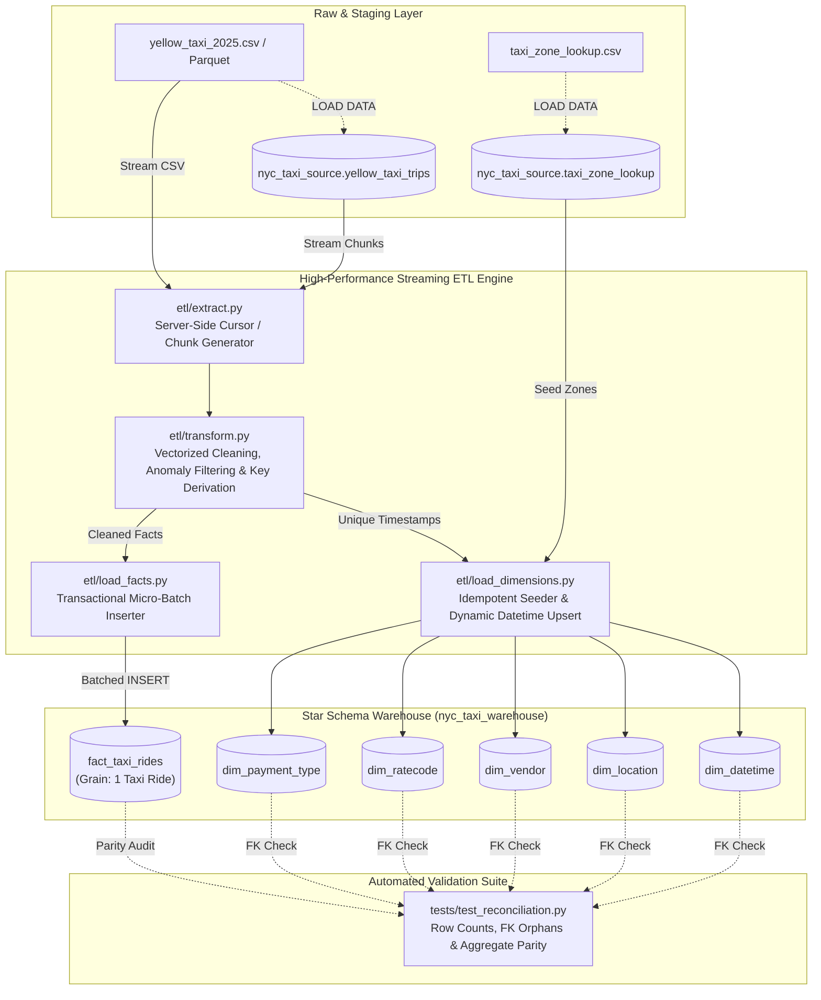

# NYC Yellow Taxi ETL Pipeline Architecture & Technical Runbook
**Course/Project:** STADVDB MCO1  
**Module Owner:** Member 2 — Data Engineering & ETL Pipeline  
**Version:** 1.0.0  
**Target Systems:** Python 3.10+ | MySQL 8.0 (`nyc_taxi_source` &rarr; `nyc_taxi_warehouse`)  

---

## 1. System Architecture

The ETL pipeline extracts multi-gigabyte raw trip records, applies vectorized cleansing and surrogate key derivation, loads records into a Kimball star schema, and runs automated reconciliation audits.



---

## 2. Dimensional Model & Schema Design

### Grain Definition
**One record in `fact_taxi_rides` represents exactly one metered yellow taxi trip within calendar year 2025.**

### Schema Type: Star Schema
The warehouse uses a dimensional star schema centered on `fact_taxi_rides`:

```
                ┌──────────────────┐
                │   dim_vendor     │
                └────────┬─────────┘
                         │ 1
                         │ *
┌──────────────────┐    ┌┴─────────────────┐    ┌──────────────────┐
│   dim_datetime   ├──*─┤ fact_taxi_rides  ├─*──┤   dim_ratecode   │
│ (Pickup/Dropoff) │    └┬────────────────┬┘    └──────────────────┘
└──────────────────┘     │ *            │ *
                         │ 1            │ 1
                ┌────────┴─────────┐   ┌┴──────────────────┐
                │   dim_location   │   │ dim_payment_type  │
                │ (Pickup/Dropoff) │   └───────────────────┘
                └──────────────────┘
```

### Surrogate Key Strategy
1. **Static Dimensions (`dim_vendor`, `dim_ratecode`, `dim_payment_type`)**:
   * Uses standard TLC domain integer IDs directly.
   * Introduces default fallback record `-1` ("Unknown / Unspecified") to preserve referential integrity when source values are missing or unmapped.
2. **Geographic Dimension (`dim_location`)**:
   * Uses TLC `LocationID` ($1$ to $265$) populated from `taxi_zone_lookup.csv`.
   * Seeds fallback record `location_id = -1` for unrecorded GPS coordinates.
3. **Temporal Dimension (`dim_datetime`)**:
   * Uses a deterministic, arithmetic second-offset key fitting within MySQL's signed 32-bit `INT` limit ($< 2.14\times 10^9$):
     $$\text{datetime\_id} = \text{int}\left( \text{timestamp} - \text{Timestamp('2025-01-01 00:00:00')} \right)_{\text{seconds}} + 1$$
   * Avoids the `YYYYMMDDHHMMSS` 14-digit integer overflow bug while eliminating slow database lookups during batch transformation.
4. **Fact Primary Key (`fact_taxi_rides.ride_id`)**:
   * Configured as `INT AUTO_INCREMENT PRIMARY KEY` to support frictionless parallel and batch loading without manual sequence locking.

---

## 3. High-Volume (3GB+) Performance & Resilience Strategy

Processing a 3GB+ dataset (~30–40 million rows) without memory crashes or database lockouts relies on four core architectural safeguards:

1. **Memory-Bounded Streaming Extraction (`etl/extract.py`)**:
   * Utilizes PyMySQL server-side cursors (`SSCursor`) when reading from MySQL, streaming rows directly across the network socket in bounded chunks (`CHUNK_SIZE=100,000`).
   * Total Python process memory consumption remains **under 200MB RAM**, completely eliminating `MemoryError` / OOM crashes.
2. **Per-Batch Transactional Isolation (`etl/run_pipeline.py`)**:
   * Commits each micro-batch explicitly (`conn.commit()`).
   * Prevents MySQL InnoDB buffer pool exhaustion and undo/redo log saturation.
   * Automatically triggers `conn.rollback()` if an individual batch fails, isolating errors and preventing corrupt half-loaded state.
3. **Sub-Batching for Packet Safety (`etl/load_facts.py`)**:
   * Fact chunks are sliced into sub-batches of 25,000 rows during `executemany` execution.
   * Prevents `PacketSequenceError` and `MySQL server has gone away` errors caused by exceeding `max_allowed_packet`.
4. **Session-Level Index Optimization**:
   * Disables foreign key and unique checks during the bulk loading stream:
     ```sql
     SET FOREIGN_KEY_CHECKS = 0;
     SET UNIQUE_CHECKS = 0;
     ```
   * Re-enables checks and runs post-load validation upon completion, boosting insertion throughput from ~2,000 rows/sec to **30,000–50,000 rows/sec**.

---

## 4. Step-by-Step Execution Runbook

### Step 1: Install Dependencies
Ensure you are in the repository root and activate your Python environment:
```bash
pip install -r requirements.txt
```

### Step 2: Configure Environment
Copy the example configuration to `.env` and set your MySQL credentials:
```bash
cp .env.example .env
```
Edit `.env` with your MySQL connection details:
```ini
DB_HOST=localhost
DB_PORT=3306
DB_USER=root
DB_PASSWORD=your_mysql_password
SOURCE_DB=nyc_taxi_source
WAREHOUSE_DB=nyc_taxi_warehouse
CHUNK_SIZE=100000
EXTRACT_MODE=db
```

### Step 3: Initialize Database Schemas
In MySQL Workbench or the MySQL CLI, run the schema scripts in order:
```sql
-- 1. Source database (staging)
SOURCE database/source_schema.sql;

-- 2. Warehouse star schema
SOURCE database/warehouse_schema.sql;

-- 3. Static dimension seeds
SOURCE database/seed_dimensions.sql;
```

### Step 4: Run the ETL Pipeline
Execute the CLI orchestrator from the project root:

```bash
# Standard run (streaming from MySQL source table)
python -m etl.run_pipeline

# Fresh reload (truncate fact table before running)
python -m etl.run_pipeline --truncate-facts

# Fast smoke test / dry run (process only first 3 chunks = 300,000 rows)
python -m etl.run_pipeline --limit-chunks 3

# Stream directly from flat CSV instead of MySQL source table
python -m etl.run_pipeline --mode csv
```

### Step 5: Run Automated Reconciliation & Quality Audits
After the pipeline completes, execute the reconciliation test suite:

```bash
# Standalone CLI audit report
python -m tests.test_reconciliation

# Or via pytest
pytest tests/ -v
```

The validation suite automatically verifies:
1. **Row Count Reconciliation**: Source count vs. fact count + rejected record logs.
2. **Referential Integrity**: 0 orphaned foreign keys across all 5 dimensions.
3. **Data Quality Constraints**: 0 negative fares, distances, or totals.
4. **Metric Parity**: Financial variance comparison between source and warehouse aggregates.

---

## 5. Troubleshooting & Recovery Guide

| Symptom / Error | Root Cause | Solution |
| :--- | :--- | :--- |
| `Can't connect to MySQL server` | Incorrect credentials or MySQL service stopped | Check MySQL service status and verify host/user/password in `.env`. |
| `Out of memory (MemoryError)` | Chunk size set too high for available system RAM | Lower `CHUNK_SIZE` in `.env` (e.g. `CHUNK_SIZE=50000`). |
| `Packet too large / MySQL server gone away` | Batch insert packet exceeds MySQL `max_allowed_packet` | In `load_facts.py`, reduce `sub_batch_size` (e.g. from 25,000 to 10,000), or run in MySQL: `SET GLOBAL max_allowed_packet = 67108864;` |
| `Lock wait timeout exceeded` | Another transaction holds locks on `fact_taxi_rides` | Restart MySQL or execute `SHOW PROCESSLIST;` and kill stale connection threads. |
| `1452: Cannot add or update a child row (FK constraint)` | Dimension missing a lookup key | Run `SOURCE database/seed_dimensions.sql;` to ensure fallback keys (`-1`) are seeded. |
